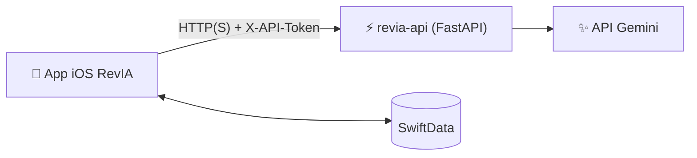

# RevIA — App iOS

**Une app iPhone qui transforme tes cours en QCM de révision, puis te dit quoi réviser chaque jour.**


> 🚧 **En développement** — Phase 1 : moteur IA

<!-- Captures à ajouter dès que les écrans existent :
<p align="center">
  
  
  
</p>
-->

Importe un PDF de cours, RevIA génère un QCM avec une explication pour chaque réponse, puis planifie tes révisions par répétition espacée. La génération passe par l'API **[revia-api](https://github.com/pmassereyes/revia-api)**, qui détient la clé de l'IA.

## Architecture



L'app suit le modèle MVVM. Elle envoie le PDF à l'API, reçoit le QCM et l'enregistre localement avec SwiftData.

## Fonctionnalités

**Génération (Phase 1)**
- [ ] Décodage des QCM (`struct QCM: Codable`) et erreurs typées `GenerationError`
- [ ] Client `APIGenerateur` : envoi multipart, mapping des erreurs HTTP
- [ ] Tests de décodage sur la réponse d'exemple partagée avec l'API

**MVP (Phase 2)**
- [ ] Bibliothèque des UE et de leurs cours
- [ ] Import d'un PDF, rattaché à une UE et une date
- [ ] Génération depuis le détail d'un cours, mise en cache, jamais de régénération implicite
- [ ] Quiz question par question, avec correction et explication immédiates
- [ ] Écran de résultats : score et liste des erreurs
- [ ] Réglages : URL de l'API et jeton stockés dans le Keychain

**Mémorisation (Phase 3)**
- [ ] Système de Leitner à 5 boîtes
- [ ] Mode « À revoir aujourd'hui », toutes UE confondues
- [ ] Statistiques par UE et par thème (Swift Charts)
- [ ] Rappel quotidien par notification locale

**Plus tard** : scan de notes papier, Share Extension, mode examen chronométré, flashcards, export Anki, widget, synchronisation iCloud.

## Choix techniques

**Pas de clé d'IA dans l'app.** L'app parle seulement à l'API, avec un jeton rangé dans le Keychain. La clé Gemini reste sur le serveur.

**La génération est derrière un protocole.** Les écrans ne savent pas d'où viennent les questions. On peut donc les tester avec de fausses données, sans serveur.

**Deux modèles pour une question.** `QCM` lit la réponse de l'API, `QuestionQCM` est la version enregistrée dans l'app, avec son suivi de révision.

**Le même exemple testé des deux côtés.** L'app et l'API testent le même fichier JSON. Si l'une change le format, un test échoue tout de suite.

**Leitner pour commencer.** Bonne réponse : la question monte d'une boîte. Erreur : elle revient à la boîte 1. Simple à coder, et remplaçable plus tard.

## Modèle de données

| Entité | Contenu |
|---|---|
| UE | nom, couleur, cours |
| Cours | titre, date, fichier source, statut de génération, questions |
| QuestionQCM | question, propositions, bonne réponse, explication, thème, boîte de Leitner, prochaine révision |
| SessionRevision | date, périmètre, score, réponses |

## Lancer le projet

Prérequis : Xcode 15+, un iPhone ou simulateur sous iOS 17+, et une instance de [revia-api](https://github.com/pmassereyes/revia-api) lancée.

```bash
git clone https://github.com/pmassereyes/revia-app.git
cd revia-app
cp Config/Secrets.example.xcconfig Config/Secrets.xcconfig   # puis renseigner API_BASE_URL et API_TOKEN
open RevIA.xcodeproj
```

En développement, l'API tourne en HTTP sur le réseau local : une exception App Transport Security est configurée pour la configuration Debug uniquement.

## Structure

```
RevIA/
├── App/            point d'entrée et vue racine
├── Models/         modèles SwiftData
├── Services/
│   ├── IA/         GenerateurQCM, APIGenerateur
│   ├── Import/     import PDF, extraction de texte, scan
│   ├── Revision/   Leitner, file de révision
│   ├── Keychain.swift
│   └── Notifications.swift
├── ViewModels/
└── Views/
RevIATests/         tests unitaires et fixtures
Config/             Secrets.example.xcconfig
```

## Licence

Tous droits réservés. Le code est consultable mais n'est pas sous licence libre.
